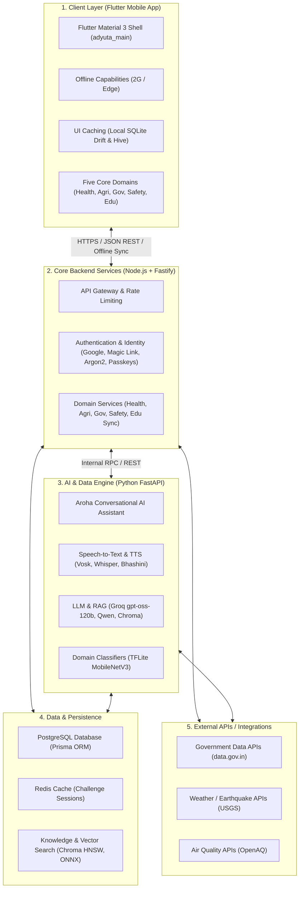

# Proof-of-Work: Section III-B — Architecture Overview & Fig. 1

**Paper Section:** III. REQUIREMENTS AND SYSTEM DESIGN — B. Architecture overview & Fig. 1 (Page 2)  
**Paper Excerpt:**
> *"The layers split between phone and cloud. The client uses flutter for input and local storage. Backend services run on node and python engines connect to data sources. Inference works in tiers with on device first when possible. Offline speech stuff is planned for later though. The whole thing is in a single repo built step by step with checks along the way. If nothing matches well it falls back instead of guessing."*
> 
> **Fig. 1:** *ADYUTA system architecture: client layer, core backend, AI and data engine, databases, external APIs, and the end-to-end voice-first pipeline.*

---

## 🏗️ Fig. 1 Architectural Subsystems Mapped to Codebase

The architecture illustrated in **Fig. 1** comprises 5 primary physical tiers and an end-to-end voice-first pipeline:



---

## 🔬 Subsystem Verification Artifacts in Repository

1. **Client Layer (`phase 3/`):**
   - Core host: [`phase 3/adyuta_main/`](file:///c:/Users/dk-32/OneDrive/Desktop/Adyuta-MP/phase%203/adyuta_main)
   - Domain packages: `health_module`, `agri_module`, `governance_module`, `safety_module`, `education_module`.
   - Offline Drift databases: [`assets/offline/health/`](file:///c:/Users/dk-32/OneDrive/Desktop/Adyuta-MP/assets/offline/health/) (All 7 databases verified `PRAGMA integrity_check == ok`).
2. **Core Backend (`phase 1/apps/backend`):**
   - Server entry: [`phase 1/apps/backend/src/server.ts`](file:///c:/Users/dk-32/OneDrive/Desktop/Adyuta-MP/phase%201/apps/backend/src/server.ts)
   - Identity & WebAuthn: [`phase 1/apps/backend/src/routes/auth.ts`](file:///c:/Users/dk-32/OneDrive/Desktop/Adyuta-MP/phase%201/apps/backend/src/routes/auth.ts) and [`passkey.ts`](file:///c:/Users/dk-32/OneDrive/Desktop/Adyuta-MP/phase%201/apps/backend/src/routes/passkey.ts)
   - Background Sync Jobs: [`phase 1/apps/backend/src/jobs/agriSync.ts`](file:///c:/Users/dk-32/OneDrive/Desktop/Adyuta-MP/phase%201/apps/backend/src/jobs/agriSync.ts), `eduSync.ts`, `govSync.ts`, `healthSync.ts`, `safetySync.ts`.
3. **AI & Data Engine (`phase 2/cloud_ai_service` & `adyuta_data_engine`):**
   - FastAPI server: [`phase 2/cloud_ai_service/main.py`](file:///c:/Users/dk-32/OneDrive/Desktop/Adyuta-MP/phase%202/cloud_ai_service/main.py)
   - Ingestion connectors: [`adyuta_data_engine/app/connectors/`](file:///c:/Users/dk-32/OneDrive/Desktop/Adyuta-MP/adyuta_data_engine/app/connectors)
   - Edge TFLite models: [`phase 2/ml_pipeline/`](file:///c:/Users/dk-32/OneDrive/Desktop/Adyuta-MP/phase%202/ml_pipeline)
4. **Data & Persistence Layer:**
   - Prisma schema: [`phase 1/apps/backend/prisma/schema.prisma`](file:///c:/Users/dk-32/OneDrive/Desktop/Adyuta-MP/phase%201/apps/backend/prisma/schema.prisma) (14 relational entities).
   - Docker Compose: [`phase 1/apps/backend/docker-compose.yml`](file:///c:/Users/dk-32/OneDrive/Desktop/Adyuta-MP/phase%201/apps/backend/docker-compose.yml) (PostgreSQL & Redis).

---

## 📌 Suggested Paper Attachment Point
**Location:** Page 2, Caption of **Fig. 1**.  
**LaTeX Caption Note:**
```latex
\caption{ADYUTA system architecture: client layer, core backend, AI and data engine, databases, external APIs, and the end-to-end voice-first pipeline. Architectural source files and component verification scripts are detailed in \texttt{paper\_proofs/04\_Section\_III\_Requirements\_and\_System\_Design/III\_B\_Architecture\_Overview\_and\_Fig1.md}.}
```
